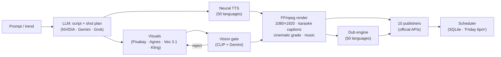

# ShortSmash ⚒️


[](LICENSE)
[](pyproject.toml)
[](tests/)
[](https://github.com/hydope/shortsmash/actions)

**Prompt in. Finished short out.**

ShortSmash is an AI video studio that takes one sentence — or today's trends — and ships a finished, captioned 9:16 short, then publishes it to YouTube, TikTok, Instagram, X, Threads, Bluesky, LinkedIn, Pinterest, and Facebook (profiles + Pages) through their **official APIs**. Script, voiceover, *verified* stock footage, karaoke captions, music ducking, trend harvesting, batch production, scheduling and comment-reply drafts, all in one CLI. And an MCP server, so AI agents can drive the whole factory.

<!-- mcp-name: io.github.hydope/shortsmash -->

```bash
shortsmash trends food                    # what's hot right now (free, no keys)
shortsmash batch food --count 5           # turn the top 5 trends into 5 videos
shortsmash serve                          # 🆕 web studio: http://localhost:8000
shortsmash agent "make a 30s reel about coffee and post it Friday at 6pm"
shortsmash post myvideo.mp4 --caption     # post YOUR video: AI title + hashtags
shortsmash post myvideo.mp4 --at "Friday 6pm" --platforms youtube,tiktok
```

```bash
git clone https://github.com/hydope/shortsmash && cd shortsmash
./install.sh                          # Windows: .\install.ps1
shortsmash "why you can't tickle yourself"   # prompt in, finished short out
```

## 🏆 Featured in

ShortSmash is listed in curated awesome lists (merged PRs):

- [ToolkitlyAI/awesome-ai-tools](https://github.com/ToolkitlyAI/awesome-ai-tools/pull/212) — AI Video
- [TensorBlock/awesome-mcp-servers](https://github.com/TensorBlock/awesome-mcp-servers/pull/4267) — MCP registry profile live on [tensorblock.co](https://tensorblock.co/mcp/servers/github-hydope-shortsmash-19af6b2a)
- [sajadh76/awesome-AI-tools](https://github.com/sajadh76/awesome-AI-tools/pull/155) — Video Generation
- [mcpHQ/awesome-mcp-servers](https://github.com/mcpHQ/awesome-mcp-servers/pull/333) — MCP Servers
- [Jenqyang/Awesome-AI-Agents](https://github.com/Jenqyang/Awesome-AI-Agents/pull/643) — AI Agents
- [Official MCP Registry](https://registry.modelcontextprotocol.io/v0/servers?search=shortsmash) — `io.github.hydope/shortsmash`, installable via `pip install shortsmash`

## 🏗️ Architecture



## 🖥️ ShortSmash Studio (web UI)

`shortsmash serve` launches a dark, fast studio in your browser — no build step:

- **🎬 Studio tab** — type a topic, hit Smash, watch it build; video previews inline
- **📈 Trends tab** — browse what's hot per niche, click any trend to use it as your topic
- **📚 Library tab** — every project, video preview, one-click publish
- **📤 Manual posts** — upload your own video, get a pre-flight check (resolution, duration, per-platform limits), AI-written title + hashtags, then post now or schedule it ("Friday 6pm") to 10 platforms
- **📊 Stats tab** — your output at a glance

## 🎬 Demo

*Made end-to-end by ShortSmash — no hand-picked clips, no human editing. LLM script, neural voice, CLIP-verified stock footage, karaoke captions, ducked music bed.*

**"How Goats Made You Addicted to Coffee"** — 49s, 1080×1920, made from one prompt. Click to play:

[](https://github.com/hydope/shortsmash/raw/master/demo/coffee-v1.mp4)

**Same video, re-voiced** — native neural voices, same verified footage:

[](https://github.com/hydope/shortsmash/raw/master/demo/coffee-v1-es.mp4) [](https://github.com/hydope/shortsmash/raw/master/demo/coffee-v1-ur.mp4) [](https://github.com/hydope/shortsmash/raw/master/demo/coffee-v1-ur-roman.mp4) [](https://github.com/hydope/shortsmash/raw/master/demo/coffee-v1-zh.mp4)

*Español · اردو · Roman Urdu · 中文 — the Mandarin version uses a native voice (not translationese) with Hanzi karaoke captions. One project, every audience.*

**More demos** — each made from a single prompt, click to play:

**Why you can't tickle yourself** — 11s, 1080×1920

[](https://github.com/hydope/shortsmash/raw/master/demo/tickle-v1.mp4)

**The deepest place on Earth** — 14s, 1080×1920

[](https://github.com/hydope/shortsmash/raw/master/demo/trench-v1.mp4)

**Why time flies faster as you get older** — 11s, 1080×1920

[](https://github.com/hydope/shortsmash/raw/master/demo/time-v1.mp4)

### 📤 Or skip the AI — post your own video

Upload any video, get a pre-flight check (resolution, duration, per-platform limits), an AI-written title + hashtags, then post now or schedule it ("Friday 6pm") to 10 platforms. In the Studio's Publish tab, or one command: `shortsmash post myvideo.mp4 --caption`


[](demo/screenshots/publish-manual-post.png)

### 🖥️ ShortSmash Studio

`shortsmash serve` — generate, browse trends, publish, and track stats from the browser:

| Studio (templates) | Settings (API keys) |
|---|---|
|  |  |
| Publish | Library |
|  |  |
| Trends | Stats |
|  |  |
| Lyrics mode | Auto pilot |
|  |  |

## Why ShortSmash

Most text-to-video tools assemble clips blindly — whatever the stock API returns first goes in. That's why automated shorts have the infamous "stock-footage look": a burger in a cooking tutorial, a parrot in a recipe video.

ShortSmash is the first open-source pipeline with **eyes**:

- **Two-stage vision gate.** Every candidate clip's middle frame is checked by a local CLIP model (offline, no quota, no cost) against 15 confuser categories — burgers, birds, houseplants, empty pans, citrus fruit — then by Gemini vision when quota allows. Wrong footage never ships.
- **Audible gate.** Renders with dead or missing audio fail instead of shipping.
- **Never ships silent.** A CC-licensed music library auto-downloads on first run; music is ducked under narration with a real FFmpeg sidechain.

## The pipeline

```
prompt ──▶ script ──▶ voice ──▶ visuals ──▶ captions ──▶ render ──▶ publish
           NVIDIA     Edge-TTS   Pixabay      faster-     FFmpeg      official
           Gemini     Piper      Veo 3.1      whisper     1080x1920   APIs only
           Grok       (offline   Kling        karaoke     +faststart
           OpenAI-    neural)    Agnes
           compat     50 langs   CLIP-verified
```

- **Script** — NVIDIA NIM (free) → Gemini (free) → Grok → any OpenAI-compatible endpoint (OpenRouter, DeepSeek, local Ollama) → offline template. Writes a scroll-stopping script *and* a strict JSON edit plan, validated by pydantic. Second-person, punchy, 3–4s scenes.
- **Voice** — Edge-TTS → Piper offline neural → gTTS fallback chain. 50 dub languages with native voices, Urdu/Hindi/Arabic included.
- **Visuals** — free Pixabay footage *or* AI generation: Google Veo 3.1 (best quality, native audio), Kling AI (top-tier motion), Agnes AI (free tier) — every clip verified by the vision gate regardless of source. Prefer your own? Set `visual_provider: custom` with any command (ComfyUI, Replicate, MiniMax…).
- **Captions** — faster-whisper word timestamps → burned-in **karaoke captions**.
- **Render** — FFmpeg: 9:16 smart reframe, transitions, hook + CTA overlays, ducked music, H.264/AAC faststart.
- **Publish** — YouTube, TikTok, Instagram, Threads, Bluesky, LinkedIn, Pinterest, X. Official APIs only — no Selenium, no scraping, nothing that gets accounts banned.
- **Dub** — `shortsmash dub <slug> --lang ur` re-voices any video in **50 languages** — Urdu, Hindi, Arabic, Spanish, French, German, Chinese, Portuguese and 42 more — plus `ur-roman` / `hi-roman` for Roman-script captions ("Tum kaise ho?") with the native neural voice. Urdu captions render in proper Nastaliq calligraphy, right-to-left, with the karaoke highlight tracking the spoken word. Same verified clips, new native narration.
- **Analytics** — `shortsmash analytics` pulls real views/likes/comments from YouTube's API. Numbers from the platform, not vanity metrics.
- **Trends** — `shortsmash trends <niche>` harvests Google News + Hacker News (free, no keys). `shortsmash batch` turns the top trends into videos unattended.
- **Schedule** — natural language ("Friday 6pm"), durable SQLite queue, retrying worker.
- **Engage** — pulls recent comments, drafts warm replies, **you approve each one with a tap**. Nothing posts itself.
- **MCP server** — `python -m shortsmash.mcp_server` exposes `generate_video`, `get_trends`, `list_projects`, `project_status` to Claude Code, Cursor, and any MCP client.
- **Resume** — `shortsmash resume <slug>` picks up failed projects from the first incomplete stage instead of redoing everything.

## How ShortSmash compares

| | ShortSmash | MoneyPrinterTurbo | OpenPost | Postiz | ShortGPT |
|---|---|---|---|---|---|
| Prompt → finished short | ✅ | ✅ | ❌ (manual editor) | ❌ | ✅ |
| Post your own video (validate + schedule) | ✅ | ❌ | ✅ | ✅ | ❌ |
| Footage verification | ✅ CLIP + Gemini | ❌ | n/a | n/a | ❌ |
| Offline neural voice fallback | ✅ Piper | ❌ | n/a | n/a | ❌ |
| Audio safety gate | ✅ | ❌ | n/a | n/a | ❌ |
| Trend harvesting (free, no keys) | ✅ | ✅ | ❌ | ❌ | ❌ |
| Batch production | ✅ | ✅ | ❌ | ❌ | ❌ |
| Karaoke word-level captions | ✅ | ✅ | ✅ | ❌ | ✅ |
| Official publishing APIs | ✅ 10 platforms | ⚠️ Selenium for YT | ✅ | ✅ | ⚠️ |
| Multi-language dubbing | ✅ 50 languages (incl. Roman Urdu/Hindi, Chinese) | ❌ | ❌ | ❌ | ✅ |
| Real analytics pull | ✅ | ❌ | ❌ | ✅ | ❌ |
| Web UI | ✅ Studio | ✅ | ✅ | ✅ | ✅ |
| MCP server | ✅ | ❌ | ✅ | ✅ | ❌ |
| Comment-reply drafts (human-approved) | ✅ | ❌ | ❌ | ❌ | ❌ |
| Resume failed projects | ✅ | ❌ | n/a | n/a | ❌ |
| License | MIT | MIT | AGPL/Commercial | MIT | MIT |
| $0 to run | ✅ | ✅ | self-host | ✅ | ✅ |

*MoneyPrinterTurbo (129K★) is the most mature; OpenPost is the best manual workspace. ShortSmash is the most engineered AI-native pipeline — the only one that checks its own work.*

## What ShortSmash will never do

No fake likes, comments, follows, shares, or stars. No botting, no "human-like" evasion of platform detection, no scraping or unofficial endpoints. That violates every platform's rules and gets accounts banned — and it doesn't work for real growth anyway. This boundary is architectural, not a policy note: the capability simply isn't in the codebase.

## Quickstart — one command

**Windows (PowerShell)** — paste this one line, done. It installs Python,
FFmpeg, Git if missing, sets everything up, and puts **ShortSmash Studio**
on your Desktop + Start Menu:
```powershell
& ([scriptblock]::Create((irm "https://raw.githubusercontent.com/hydope/shortsmash/master/install.ps1")))
```

**Windows (CMD)** — same thing, one line in Command Prompt:
```cmd
curl -L -o "%TEMP%\rf-install.cmd" "https://raw.githubusercontent.com/hydope/shortsmash/master/install.cmd" && "%TEMP%\rf-install.cmd"
```

**Linux / macOS / Git Bash (Windows)** — one line, works everywhere including
Git Bash on Windows:
```bash
curl -fsSL "https://raw.githubusercontent.com/hydope/shortsmash/master/install.sh" | bash
```

After install, launch **ShortSmash Studio** from the Start Menu / Desktop
(Windows) or run `shortsmash serve` → open http://127.0.0.1:8000.

Prefer it manual? Download the repo and double-click **`install.bat`**
(Windows) or run `./install.sh` (Linux/macOS).

Cloning just for the code? The full repo is ~213 MB of demo videos — skip
them with a sparse checkout:

```bash
git clone --depth 1 --filter=blob:none --sparse https://github.com/hydope/shortsmash.git
git -C shortsmash sparse-checkout set shortsmash scripts fonts
```

If an earlier install failed halfway, delete the ShortSmash folder and
re-run the one-liner.

Needs Python 3.11–3.13 and ffmpeg. The Windows one-line installers fetch
both for you if missing — and if your machine already has Python 3.14, they
install 3.13 (PowerShell) or 3.12 (CMD) side by side and use that instead,
since 3.14 cannot build a working virtual environment yet. Installs fetch
code only (~2 MB, no demo videos).

Make a video in the 🎬 Studio tab, then hit the 🚀 **Publish tab** to post it to
10 platforms (YouTube, TikTok, Instagram, X, Threads, Bluesky, LinkedIn,
Pinterest, Facebook, Facebook Page) in one click — with per-platform setup status and dry-run safety.

Manual install, if you prefer it piecemeal:

```bash
pip install 'shortsmash[ai,voice,captions,trends,vision,mcp,youtube,x,schedule]'
shortsmash init          # guided setup: keys, voice, defaults
shortsmash doctor        # verify every dependency

# Your first video (needs a free Pixabay key + any LLM key)
shortsmash new "coffee" --duration 30

# Ride the trends
shortsmash trends ai --limit 5
shortsmash batch ai --count 3

# Hands-free
shortsmash agent "make a 30s reel about the top AI trend and post it Friday at 6pm"
```

Free keys: [Pixabay](https://pixabay.com/api/docs/) (footage) · [Google AI Studio](https://aistudio.google.com/) (Gemini LLM) · [NVIDIA NIM](https://build.nvidia.com/) (LLM). Or point `openai_base_url` at local Ollama and pay nothing at all.

## Docs

Per-platform publishing setup (official APIs):
- `docs/setup-youtube.md`, `setup-tiktok.md`, `setup-instagram.md`, `setup-x.md`
- `docs/setup-threads.md`, `setup-bluesky.md`, `setup-linkedin.md`, `setup-pinterest.md`, `setup-facebook.md`, `setup-facebook_page.md`
- `docs/trends.md` — trend sources and scoring
- `docs/mcp.md` — MCP server setup for Claude Code / Cursor
- `docs/visual-providers.md` — plugging in AI visual generation

## License

MIT — build whatever you want.
